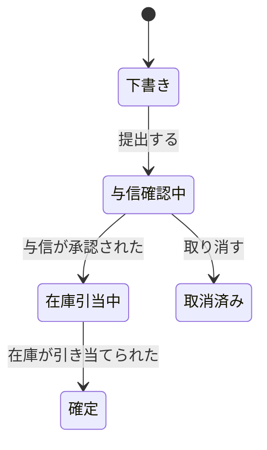
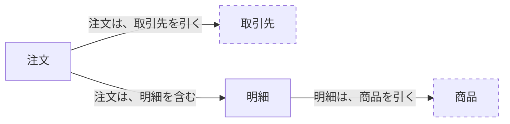

# 表記法

この文書は、[document-system.md](document-system.md) の文書に、何をどの表記で書くかを定める。

- 表記には、会話のための表記と、記録のための表記がある。この文書が定めるのは、記録のための表記である。
  - ワークショップの付箋や図のような会話の表記は、その場で使って捨てる。合意したことは、この文書の表記で転記する（[processes.md](processes.md)）。
- 記録のための表記は、次の三つである。
  - 表：顧客と共有する文書の、主な表記。
  - 記法の部分集合：顧客と共有する文書で、業務上の形を書くための、少ない語の記法。
  - 記法の全体：論理モデルで、コードがまだないときに、形と操作を書くための記法。
- 図は、表かテキストの定義から描く。表から描いた図は、元の表を一行書いて、表のすぐ後に置く（§5）。それ以外の手で描いた図は保存しない（[document-system.md](document-system.md) §4.4）。

## 1. どこで、どの表記を使うか

| 文書 | 表 | 記法の部分集合 | 記法の全体 |
| --- | --- | --- | --- |
| `domain/glossary.md` | 使う | — | — |
| `domain/contexts.md` | 使う（受け渡しの約束） | — | — |
| `domain/facts.md` | 使う（事実の一覧） | 使ってよい（事実が運ぶ情報） | — |
| `domain/things.md` | 使う（業務の対象の形） | 使ってよい（選択肢のある部分） | — |
| `domain/rules.md` | 使う（業務ルール、判定、例） | 使ってよい（許される答えが運ぶ情報） | — |
| `domain/lifecycles.md` | 使う（状態遷移表） | — | — |
| `design/model/` | 使う（不変条件、論理型の属性） | — | 使ってよい（コードがまだないとき） |

- 選択肢ごとに運ぶ情報が違う形は、記法の部分集合のブロックでも書く。そのときは、必ず例と表を並べる。部分集合のブロックだけで、顧客と合意しない（§3.3）。
- 業務の対象の形（注文が何から成るか、など）は、表で書く（§2.6）。ブロックは、選択肢のある部分にだけ使う。
- 記法の全体は、顧客と共有する文書では使わない。

## 2. 表

### 2.1 業務ルール

業務ルールは、手順に埋め込まず、用語集の言葉で、一つずつ宣言的な文で書く。例外は、本文に埋め込まず、別のルールにする [Business Rules Group 2003]。

| 識別子 | ルール | 出所 | 合意状態 | 検証 |
| --- | --- | --- | --- | --- |
| RULE-ORDER-01 | 明細が 1 件もない注文は、提出できない | 要求資料 §6 | 仮説 | なし |

- ルールごとに、例と、まだ答えのない問いを添える。ルール・例・問いの三つ組は、具体例でルールを確かめる手法の考えに倣う [Wynne 2015]。
  - 業務ルールの例：ふつうの例、境界の例、違反の例。
  - 答えの出ない問いは、未決事項にして識別子で引く。
- 数量や期間を含むルールには、境界の例を少なくとも一つ置く。

### 2.2 判定

判定は、業務上の問いと、その許される答えの組である。問い、入力、許される答えを先に書き、判定の中身（どう決めるか）は、その後に書く [Taylor 2023b]。

| 識別子 | 問い | 入力とその定義 | 許される答え | 生じる事実 | 出所 | 合意状態 |
| --- | --- | --- | --- | --- | --- | --- |
| JDG-CREDIT-01 | この注文を、与信の面から受けてよいか | 取引停止中か（与信が持つ区分。誰が登録するかは Q-17）。注文の金額（「与信の判定を依頼する」で受け取る。税込みか税抜きかは Q-02）。使える与信の額（RULE-CREDIT-02 で計算する）。高リスクの商品を含むか（明細の商品は「与信の判定を依頼する」で受け取る） | 自動で承認する／与信担当者が審査する／断る | 与信が承認された／与信の審査が依頼された／与信が断られた | 要求資料 §5 | 要確認（Q-06） |

- 許される答えは、ここで一度だけ定義する。答えごとに、それによって生じる業務上の事実の名前を書く。状態遷移表と受け渡しの約束は事実の名前を、操作の結果は答えの名前を引く。
- 入力は、どの値を、どの定義で使うかまで書く。決まっていなければ未決事項を引く。
- 判定は、入力への依存で書く。どの順で確かめるかという手順は、判定に書かない [Taylor 2023a]。

**決定表**

判定の中身が条件の組み合わせで決まるときは、決定表で書く。

| U | 取引停止中か | 注文の金額が、使える与信の額を超えるか | 高リスクの商品を含むか | 答え |
| --- | --- | --- | --- | --- |
| 1 | はい | — | — | 断る |
| 2 | いいえ | はい | — | ？（Q-06） |
| 3 | いいえ | いいえ | はい | 与信担当者が審査する |
| 4 | いいえ | いいえ | いいえ | 自動で承認する |

- 決定表の 1 行は、条件の組み合わせと答えの一つの対応である。行の中の条件は、すべて成り立つ（AND）。
- `—` は、その行ではその条件を見ないことを表す [Vanthienen 2012a]。
- 範囲は、端を含むかを括弧で書く。`[100,000..150,000)` は、10 万円以上、15 万円未満である。
- 左上のマスに、ヒットポリシー（複数の行が当てはまったときの決め方）を書く [OMG 2024]。既定は `U`（Unique。どの入力にも、当てはまる行は一つだけ）とする。ほかを使うときだけ、理由を書く。
- 条件の値を列挙で定義し、組み合わせの数を数えて、抜けと重なりを確かめる（上の表では 2×2×2＝8 通りを 4 行で覆う）。
- 例は、許される答えごとに一つ以上と、境界の例を置く。
- 資料の記述が食い違う行は、どちらも採らず、答えの欄を `？（Q-xx）` にする。食い違う記述は、表の下に、それぞれの出所とともに並べる。上の表の行 2 では、次の二つが食い違う。
  - 要求資料 §4：限度額を超える注文は、断る。
  - 要求資料 §5：使える与信の額を超える注文は、与信担当者が審査する。

### 2.3 状態遷移表

| 現在の状態 | 操作または出来事 | 条件 | 次の状態 | 合意状態 |
| --- | --- | --- | --- | --- |
| 下書き | 提出する | 明細が 1 件以上（RULE-ORDER-01） | 与信確認中 | 仮説 |
| 与信確認中 | 与信が承認された | — | 在庫引当中 | 仮説 |
| 与信確認中 | 取り消す | 出荷が始まる前 | 取消済み | 要確認（Q-12） |
| 取消済み | 与信が承認された | — | ？（Q-14） | 要確認 |
| 下書き | 取り消す | — | ？（Q-13） | 要確認 |

- 出来事は、`facts.md` の事実の名前で書く。ほかのコンテキストから届く事実も行にする。
- 取消などと、届く事実の前後が入れ替わる組み合わせも行にする（上の例の「取消済み」に「与信が承認された」が届く行）。
- 次の状態の欄の記号
  - `×`：受け付けない。拒否の理由を返す。
  - `／`：起こりえない。なぜ起こりえないかを、条件か注に書く。
  - `？`：まだ決まっていない。未決事項を引く。
- 状態と出来事のすべての組み合わせを並べ、空いたマスを残さない。空いたマスは、`×`、`／`、`？` のどれかで埋める。
- 表の下に、終端の状態と、そこからやり直せるか（再提出など）、放置されたときの扱い（時間切れなど）を書く。
- 状態を、業務上の事実から導くのか、それ自体を保持するのかは、論理モデルに書く（[document-system.md](document-system.md) §4.2）。
- 状態ごとに持つ情報は、ここに書かず、`things.md` の、状態を持つ対象の形の表に書く（§2.6）。

### 2.4 業務上の事実

| 事実 | 起きるコンテキスト | 運ぶ情報 | 意味 | 合意状態 |
| --- | --- | --- | --- | --- |
| 注文が提出された | 受注 | 注文、取引先、注文の金額（提出の後に明細を変えられるかは Q-15）、提出した日時 | 受注担当者が、入力を終えた注文を提出した | 仮説 |

- 名前は、過去形の業務上の出来事にする（「〜された」「〜した」）。技術的なログは書かない。
- 取消や訂正は、元の事実を消さず、元の事実を引く新しい事実として書く（例：「引当が解除された」は、元の引当と、解除の理由と、解除した日時を運ぶ）。誤った記録の訂正と、実際の取消は、別の事実にする（[data-modeling-pattern-language](https://github.com/matarillo/data-modeling-pattern-language)）。
- 主な流れは、事実の並びとして書く。
- 運ぶ情報には、業務の対象の名前を書く。対象が何から成るかは `things.md` に書き（§2.6）、事実の表には写さない。受け手が使う部分を示すために、対象の一部（注文の金額など）を挙げてもよい。
- 後で元の値が変わっても変えずに持つ値は、「提出した時点の単価」のように、名前で分かるように書く。元の値と一緒に変わるのか、その時点の値のまま残るのかが決まっていなければ、どちらとも書かず、未決事項を引く。AI がどちらかに決めない。

### 2.5 受け渡しの約束

| 送り手 | 受け手 | 運ぶ情報 | 重複を見分ける鍵 | 失敗したときの扱い | 合意状態 |
| --- | --- | --- | --- | --- | --- |
| 受注 | 与信 | 取引先、判定の対象の金額、通貨、判定の基準の日時 | 注文の識別子 | 結果が届かないときは、照会し直す。同じ注文の二度目の依頼は、最初の結果を返す | 仮説 |

- 方式（同期か非同期か、通信の手段）は書かない。アーキテクチャ設計で決める。
- 関係の種類の名前（顧客・供給者 Customer/Supplier など）を使うときは、平易な説明を添える。この名前の「顧客」は、関係の下流を指す語で、発注者としての顧客とは別である。
- 受け手は、送り手の内部の状態を直接書き換えない。

### 2.6 業務の対象の形

注文、明細、取引先のような業務の対象が、何から成り、何で見分けるかを、対象ごとに書く。置き場は `domain/things.md` で、コンテキストごとに節を分ける。`things.md` の冒頭には、次の二つを書く。

- 先に `facts.md` の事実の流れを読む。この文書には、事実と受け渡しの約束が運ぶ業務の対象について、何から成り、何で見分けるかだけを書く。
- 表の「その情報についての業務ルール（要約）と、未決事項」の欄は、`rules.md` の業務ルールを短くまとめたものである。食い違うときは、`rules.md` が正である。

業務の対象ごとに、次を書く。

| 業務の対象ごとに書く項目 | その項目に書くこと |
| --- | --- |
| 対象の種類 | 出来事の記録か、続いて在るものか。出来事の記録は、ある時点に起きたことを記録した対象である（注文、見積の依頼など）。続いて在るものは、業務の中で続いて在り、持つ情報が変わっていく対象である（取引先、商品など）。分け方は、[data-modeling-pattern-language](https://github.com/matarillo/data-modeling-pattern-language) の資源とイベントの分け方による。ほかの対象の一部（明細など）は、その対象の種類に従う |
| この対象が初めて記録される事実 | その対象が初めて記録される、業務上の事実の名前。外から受け取る対象なら、代わりに「この対象を外から受け取る約束」として、受け渡しの約束の名前を書く。事実も約束も見つからなければ、対象を書かずに未決事項にする |
| この対象が持つ情報を変える事実や操作 | その対象が持つ情報を後で変える、業務上の事実や操作の名前。なければ「なし」と書く |
| 同じ対象とみなす条件 | 二つの記録を同じ対象とみなすのは、どういうときかを、業務の言葉で書く。システムが付ける番号で見分けるかも、顧客に確かめる。決まったら、受け渡しの約束（§2.5）の「重複を見分ける鍵」の欄に、この条件の名前を書く |
| この対象の形を書く表 | 状態を持つ対象か、持たない対象かで、下の二つの表のどちらかにする |
| 値を入れた見本 | 値を入れた一件か数件。表の下に書く |

**状態を持つ対象**（`lifecycles.md` に状態遷移表がある対象）は、状態ごとに列を立てた表で書く。列の名前は「状態が〈状態の名前〉のとき」とし、状態の名前は `lifecycles.md` の名前を使う。同じになる状態は、まとめて一つの列にしてよい。そのときは、まとめた状態の名前を、列の名前に括弧で並べる。表のマス（情報の行と、状態の列が交わる所）には、必ずある、ない、あってもよい、0 件以上、1 件以上、1〜10 件のような範囲、？（未決事項を引く）のどれかを書く。空いたマスを残さない。

**注文**（受注）

- 対象の種類：出来事の記録
- この対象が初めて記録される事実：注文が下書きとして保存された
- この対象が持つ情報を変える事実や操作：明細を変更する操作（下書きの間だけ）
- 同じ対象とみなす条件：？（Q-37）。この条件の合意状態：要確認

| この対象が持つ情報 | 状態が下書きのとき | 提出した後の状態のとき（与信確認中、在庫引当中、確定、出荷中、出荷済み、断った） | 状態が取消済みのとき | その情報の値は、どこから来るか | その情報についての業務ルール（要約）と、未決事項 | 合意状態 | 出所 |
| --- | --- | --- | --- | --- | --- | --- | --- |
| 取引先 | 必ずある | 必ずある | 必ずある | お客様が注文書で知らせ、受注担当者が入力する（注文が下書きとして保存された） | 取引先を引くだけか、その時点の値を写すかは ？（Q-40） | 要確認（Q-40） | 要求資料 §3、§4 |
| 明細 | 0 件以上 | 1 件以上 | ？（Q-13） | 同上。下書きの間は、明細を変更する操作で変わる | 提出するには 1 件以上（RULE-ORDER-01）。確定した後は変えられない（RULE-ORDER-04） | 仮説 | 要求資料 §6 |
| 注文の金額 | 必ずある | 必ずある | 必ずある | 明細から計算する | 明細の金額の合計（RULE-ORDER-03） | 要確認（Q-02） | 要求資料 §6 |

値を入れた見本：？（Q-39。注文書の記入例を、個人の情報などを伏せて、お客様からもらう）

**状態を持たない対象**（状態遷移表がない対象）は、情報ごとに、必ずあるかと、いくつあるかを書く。

| この対象が持つ情報 | その情報は、必ずあるか | その情報は、いくつあるか | その情報の値は、どこから来るか | その情報についての業務ルール（要約）と、未決事項 | 合意状態 | 出所 |
| --- | --- | --- | --- | --- | --- | --- |

- 書くのは、着手する機能に要る業務の対象のうち、初めて記録される事実か、外から受け取る約束があるものだけである。
- 「ないことがある」と書くときは、どんなときにないかを、業務ルールと未決事項の欄に書く（例：「見積だけ」の依頼のときはない）。分からなければ ？ にして、未決事項を引く。状態によってないなら、状態を持つ対象の表にする。
- 「その情報の値は、どこから来るか」の欄には、次のどれかを書く。業務の相手や現物から知らされる（誰が、何を見て。どの事実で）。担当者が決める（誰の権限で。どの事実か判定で）。前に起きた事実から。外から受け取る（どの約束で）。ほかの値から計算する（どの業務ルールで）。後で変わる情報には、変える事実か操作も書く。分からなければ ？ にして、未決事項を引く。
- 業務ルールで決まっていることは、要点を値まで書いてよい。そのときは、ルールの識別子を添える。食い違うときは、`rules.md` に合わせて直す。
- 出来事の記録が、続いて在るものを引く行（例：注文の取引先）には、引くだけか、その時点の値を写すかを、業務ルールと未決事項の欄に書く。決まっていなければ ？ にして、未決事項を引く。AI がどちらかに決めない。
- 書かないもの：キー、データの型、継承など、システムの組み立て方に関わること。記録した日時、更新した人、削除の印など、システムが付ける情報。これらは論理モデルに置く。
- 外から受け取る対象は、このコンテキストが使う部分だけを書き、持ち主のコンテキストを添える。
- 値を入れた見本は、表の下に書く。値は、顧客の資料（記入済みの帳票の、伏せた写しなど）から取り、AI は値を作らない。資料に値がなければ、見本を ？ にして、未決事項を引く。ふつうの一件と、珍しいが現実的な一件を置き、多くても 3〜5 件にする。業務ルールの例と同じものは、ルールの例を識別子で引く。
- 新しく書いた業務の対象の形の表にも、[processes.md](processes.md) §3 手順 3 の歪みの点検表を当てる。
- 業務の対象の図は、この表から描く（§5）。

## 3. 記法

記法は、データの形を「すべて必要（AND）」と「どれか一つ（OR）」の組み合わせで書く、テキストの記法である。ドメインを文書にするための記法として示されたもの [Wlaschin 2018 §2.4] と、それを元に業務の概念を表すよう整理した記法 [kawasima 2021] に倣う。

### 3.1 記法の部分集合

顧客と共有する文書で使ってよいのは、次の語と記号だけである。

| 書き方 | 意味 |
| --- | --- |
| `data A = B AND C` | A は、B と C のすべてから成る |
| `data A = B OR C OR D` | A は、B、C、D のどれか一つである |
| `B?` | B は、あってもなくてもよい |
| `List<B>` | B が複数ある（0 個以上） |
| `???` | まだ決まっていない。後ろに、未決事項の識別子だけを `// Q-12` のように書く |

- 名前には、用語集か、`domain/` の表で定義した名前だけを使う。
- 許される答えと状態の名前は、表で定義した名前をそのまま使う。新しい答えや状態を、記法の中で足さない。

例（判定の許される答えと、各答えが運ぶ情報）：

```text
data 与信の判定の結果 =
  自動で承認する
  OR 与信担当者が審査する
  OR 断る

data 断る = 断る理由 AND 判定の日時
data 断る理由 = 取引停止中 OR 審査での不承認
```

この例は、`rules.md` の JDG-CREDIT-01 の表と例と並べて置く。

### 3.2 記法の全体

論理モデル（`design/model/`）で、コードがまだないときにだけ使う。部分集合に、次を加える。

| 書き方 | 意味 |
| --- | --- |
| `behavior 操作の名前 = 入力 -> 結果` | 操作は、入力を受け取り、結果を返す。結果は、成功と、拒否や失敗の `OR` で書く |
| `// RULE-CREDIT-02、INV-CREDIT-01` | 注釈。ルールや不変条件は、識別子だけを引き、文を写さない |

```text
behavior 与信を判定する =
  注文の金額 AND 使える与信の額 AND 取引停止中か AND 高リスクの商品を含むか
  -> 与信の判定の結果
// JDG-CREDIT-01
```

- ワークフロー（操作の並び）は、次の項目で書く。
  - きっかけになる事実
  - 主な入力と、ほかの入力
  - 結果として起きる事実
  - 副作用
- 操作は、すべての入力に結果を返すように書く。失敗も結果の `OR` の一つにし、「例外が起きる」とは書かない。
- 状態は、フラグで書かず、状態ごとに別の形を `OR` で並べる。

### 3.3 書く場所と、守ること

- 一つの形は、一か所でだけ定義する。業務上の形（業務の対象の形と、状態ごとに持つ情報、事実が運ぶ情報、許される答え）は `domain/` で定義し、論理モデルはその名前を引いて、モデルに要る構造だけを足す。
- 許される答え、状態、形の名前が、表と記法で一致していることを、道具で確かめる。
- 業務の対象の形の表と、記法の部分集合のブロックに決定の印を付けるのは、読み合わせの場で、顧客が下の表の問いに答えた後に限る。見た目でよいと言われただけでは、決定にしない。
- 業務の対象の読み合わせは、値を入れた見本から始める。AI は、見本と業務の対象の形の表を見比べ、業務ルールの候補を問いにして出す（例：この見本では、届け先がお客様の住所と違います。いつも許されますか）。顧客が採った候補だけを、表の行の決定にする。採らなかった候補は、加えない [Ramdoyal 2010]。
  - 記法を顧客が読めるかは、確かめていない仮説である。読めないと分かったら、部分集合を使わず、表と例だけで書く。
- コードができたら、記法の全体のブロックを、コードの型の名前と、論理型の属性の表に置き換える。既存のコードから入るときは、記法の全体を書かない。

読み合わせの問い（業務の対象の形の表と、記法の部分集合のブロックに使う。ほかの文書は、この表を引く）

| 読み合わせで確かめること | 問いの例 |
| --- | --- |
| どれか一つになるか（`OR`） | この場合は、どの結果になりますか。この選択肢のほかに、ありますか。両方になることはありますか |
| その情報は、必ずあるか（`AND`、`?`） | 〜がない〜はありますか。ないのは、どんなときですか。そのとき、業務で困りますか |
| その情報は、いくつあるか（`List`） | 〜が 1 件もないことはありますか。いちばん多いときは、いくつですか |
| その情報は、どの状態のときにあるか | この状態のとき、〜はありますか。ないのは、どの状態ですか |
| 同じ対象とみなす条件 | 何が一つの〜ですか。二つが同じだと言えるのは、どういうときですか。名前が変わっても、同じ〜ですか。同じ〜が二度届いたら、同じものですか |
| その時点の値のまま残るか | 後で元の値が変わったら、この値も変わりますか |

## 4. 論理型の語彙

論理モデルの属性は、実装の型ではなく、業務上の意味を表す論理型で書く。意味が違うものは、実装の型が同じでも、別の論理型にする。

| 論理型 | 意味 |
| --- | --- |
| 識別子 | 業務の対象を一意に指す値 |
| 参照 | ほかの業務の対象の識別子 |
| テキスト | 業務上の意味を持たない文字列（名前、説明） |
| 金額 | 通貨を伴う額。負にならない |
| 差額 | 二つの金額の差。負になりうる |
| 数量 | 個数。負にならない |
| 比率 | 割合 |
| 発生日時 | 業務上の出来事が起きた時点 |
| 有効期間 | 値や関係が業務上有効である期間 |
| 記録日時 | システムが記録した時点 |
| 日付、年 | 暦の上の日や年 |
| 真偽 | はい／いいえ |
| 列挙 | 決められた選択肢のどれか（`OR` で定義する） |
| 外部資源の参照 | システムの外にある資源（画像、文書）の所在 |

- 時間に関わる属性は、発生日時、有効期間、記録日時のどれかを選ぶ。業務がその区別を必要としないときは、発生日時だけでよい（[data-modeling-pattern-language](https://github.com/matarillo/data-modeling-pattern-language)）。
- 導いた値（ほかの値から計算できる値）は、属性の表で「導く」と書き、計算のルールの識別子を引く。

## 5. 図

顧客と表を読み合わせるときは、図を添えると伝わりやすい。人は、表だけから、つながりや移り変わりの全体を思い描くのが難しい。そこで、表から描ける図（状態遷移図、コンテキストマップの図、業務の対象の図）は、原則として、表から描いて、表のすぐ後に置く。正は表であり、図は表を見やすくしたものである。次のときは、図を描かなくてよい。図にすると箱が一つだけになるとき（コンテキストが一つだけのコンテキストマップなど）。図にすると、分かれ道も戻る線もない一本道になり、箱が二つ以下のとき。迷うときは描く。

- 図の直前に一行、元の表を書く（例：「この図は、上の表から描いた。食い違うときは、表が正である」）。図の中の一つ一つの要素に、リンクや識別子を付けなくてよい。
- 表を直したら、同じ変更の中で図も描き直す。図だけを直さない。
- 図では、「できないこと」「その情報が必ずあるか」「まだ決まっていないこと」を見落としやすい。決めるのは、表の行についてである。図で気づいたことは、表の行に戻して確かめる。
- 状態遷移図には、次の状態が決まっている行を、すべて描く。次の状態が決まっていない行は、描かなくてよい。そのときは、図の直前の一行に、次の三つを書く。受け付けない組み合わせ（×）、起こりえない組み合わせ（／）、まだ決まっていない組み合わせ（？）は、表にだけあること。まだ決まっていない組み合わせが、表に何行あるか。図に描いた行にも、顧客とまだ合意していない行がありうるので、合意状態は表で確かめること。
- 表から道具で図を作り直せるときは、[document-system.md](document-system.md) §4.4 の派生物として置いてよい。
- 業務の対象の図の描き方：どんな対象があり、どれがどれを含み、どれを引き、どれを外から受け取るかだけを描く。件数や業務ルールは書かない（表に書いてある）。箱は業務の対象にし、矢印の言葉は業務の言葉（「注文は、明細を含む」「注文は、取引先を引く」）にする。データベースの図の記号やキー、継承の矢印は使わない。外から受け取る対象と、この文書で書かない対象は破線にする。まだ決まっていないつながりには「？」と未決事項の識別子を書く。着手する機能が触る対象だけを描く。

例（状態遷移表から描いた図）：

この図は、例題の `lifecycles.md` の注文の状態遷移表から、例のために一部の行を抜き出して描いた（例題の図は、次の状態が決まっている行をすべて描いている）。食い違うときは、表が正である。



例（業務の対象の形の表から描いた図）：

この図は、例題の `things.md` の、注文と明細の、業務の対象の形の表から描いた。食い違うときは、表が正である。破線は、この文書で書かない対象である。


