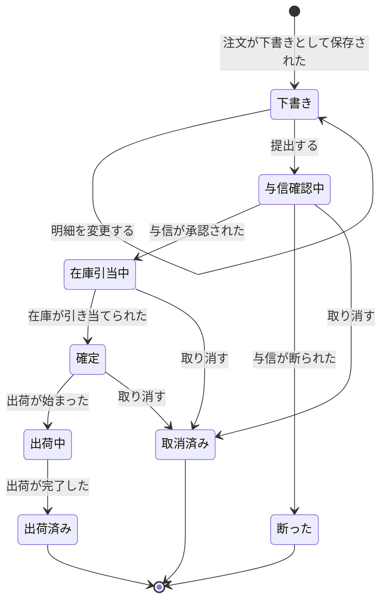

# 業務の状態の移り変わり

状態は、要求資料 §7 の八つである。状態の名前は、そのまま使う。

## 注文

### 状態遷移表

- 状態は、下書き、与信確認中、在庫引当中、確定、出荷中、出荷済み、断った、取消済みの八つである。
- 出来事は、操作（提出する、取り消す、明細を変更する）と、`facts.md` の事実（ほかのコンテキストから届くものを含む）である。
- 同じ答えになる状態は、1 行にまとめ、現在の状態の欄に列挙した。出来事ごとに、八つの状態のすべてが、ちょうど一度ずつ現れる。
- 出所の「案」は、要求資料に直接の記述がなく、AI が空いたマスを埋めたものである。

| 現在の状態 | 操作または出来事 | 条件 | 次の状態 | 合意状態 | 出所 |
| --- | --- | --- | --- | --- | --- |
| （なし） | 注文が下書きとして保存された | — | 下書き | 仮説 | 要求資料 §4 手順 2 |
| 下書き | 提出する | 明細が 1 件以上（RULE-ORDER-01） | 与信確認中 | 仮説 | 要求資料 §4 手順 3、§6 |
| 下書き | 提出する | 明細が 0 件 | ×（拒否の理由：明細がない） | 仮説 | 要求資料 §6 |
| 与信確認中、在庫引当中、確定、出荷中、出荷済み | 提出する | — | ×（拒否の理由：提出済み） | 仮説 | 案 |
| 断った、取消済み | 提出する | — | ？（Q-21） | 要確認（Q-21） | 案 |
| 下書き | 取り消す | — | ？（Q-13） | 要確認（Q-13） | 要求資料 §6 |
| 与信確認中、在庫引当中、確定 | 取り消す | 出荷が始まる前（RULE-ORDER-05、Q-12） | 取消済み | 要確認（Q-12） | 要求資料 §6 |
| 出荷中、出荷済み | 取り消す | — | ×（拒否の理由：出荷が始まっている） | 仮説 | 要求資料 §6 |
| 断った | 取り消す | — | ？（Q-30） | 要確認（Q-30） | 案 |
| 取消済み | 取り消す | — | ×（拒否の理由：取り消し済み） | 仮説 | 案 |
| 下書き | 明細を変更する | — | 下書き | 仮説 | 要求資料 §4 手順 2 |
| 与信確認中、在庫引当中、断った、取消済み | 明細を変更する | — | ？（Q-15） | 要確認（Q-15） | 要求資料 §6 |
| 確定、出荷中、出荷済み | 明細を変更する | — | ×（拒否の理由：確定した注文の明細は変更できない。RULE-ORDER-04） | 仮説 | 要求資料 §6 |
| 与信確認中 | 与信が承認された | — | 在庫引当中 | 仮説 | 要求資料 §4 手順 5 |
| 取消済み | 与信が承認された | — | ？（Q-14） | 要確認（Q-14） | 案 |
| 下書き、在庫引当中、確定、出荷中、出荷済み、断った | 与信が承認された | — | ／（提出前は判定がない。判定済みの注文に、新しい結果は届かない。失効後のやり直しは Q-10） | 仮説 | 案 |
| 与信確認中 | 与信が断られた | — | 断った | 仮説 | 要求資料 §4 手順 4 |
| 取消済み | 与信が断られた | — | ？（Q-14） | 要確認（Q-14） | 案 |
| 下書き、在庫引当中、確定、出荷中、出荷済み、断った | 与信が断られた | — | ／（理由は、与信が承認された の行と同じ） | 仮説 | 案 |
| 在庫引当中 | 与信の判定が失効した | 7 日のうちに注文が確定していない（RULE-CREDIT-03、RULE-CREDIT-04） | ？（Q-10） | 要確認（Q-10） | 要求資料 §5 |
| 下書き、与信確認中、確定、出荷中、出荷済み、断った、取消済み | 与信の判定が失効した | — | ／（失効するのは、承認された判定が、確定するまでの間だけ。RULE-CREDIT-03、RULE-CREDIT-04） | 仮説 | 案 |
| 在庫引当中 | 在庫が引き当てられた | — | 確定 | 仮説 | 要求資料 §4 手順 6 |
| 取消済み | 在庫が引き当てられた | — | ？（Q-14） | 要確認（Q-14） | 案 |
| 下書き、与信確認中、確定、出荷中、出荷済み、断った | 在庫が引き当てられた | — | ／（与信の承認の後にだけ、引当を依頼する） | 仮説 | 要求資料 §4 手順 5 |
| 在庫引当中 | 在庫が引き当てられなかった | — | ？（Q-01） | 要確認（Q-01） | 要求資料 §8 |
| 取消済み | 在庫が引き当てられなかった | — | ？（Q-14） | 要確認（Q-14） | 案 |
| 下書き、与信確認中、確定、出荷中、出荷済み、断った | 在庫が引き当てられなかった | — | ／（与信の承認の後にだけ、引当を依頼する） | 仮説 | 要求資料 §4 手順 5 |
| 確定 | 出荷が始まった | — | 出荷中 | 仮説 | 要求資料 §4 手順 7 |
| 取消済み | 出荷が始まった | — | ？（Q-14） | 要確認（Q-14） | 案 |
| 下書き、与信確認中、在庫引当中、出荷中、出荷済み、断った | 出荷が始まった | — | ／（確定した注文にだけ、出荷を指示する。出荷中は、始まった後の重複） | 仮説 | 要求資料 §4 手順 7 |
| 出荷中 | 出荷が完了した | — | 出荷済み | 仮説 | 要求資料 §4 手順 7 |
| 下書き、与信確認中、在庫引当中、確定、出荷済み、断った、取消済み | 出荷が完了した | — | ／（出荷が始まった注文にだけ、完了が起きる） | 仮説 | 案 |

この図は、上の状態遷移表のうち、次の状態が決まっている行から描いた。受け付けない組み合わせ（×）、起こりえない組み合わせ（／）、まだ決まっていない組み合わせ（？）は、表にだけある。まだ決まっていない組み合わせは、表に 11 行ある。図に描いた行にも、顧客とまだ合意していない行があるので、合意状態は表で確かめる。食い違うときは、表が正である。

### 終端の状態と、放置されたときの扱い

| 状態 | 終端か | 放置されたときの扱い | 合意状態 | 出所 |
| --- | --- | --- | --- | --- |
| 下書き | 終端でない | ？（Q-22） | 要確認（Q-22） | 案 |
| 与信確認中 | 終端でない | ？（Q-22。審査待ちの放置を含む） | 要確認（Q-22） | 案 |
| 在庫引当中 | 終端でない | 承認の判定は 7 日で失効する（RULE-CREDIT-03、RULE-CREDIT-04）。在庫が足りないまま待つ扱いは Q-01 | 要確認（Q-01、Q-10） | 要求資料 §5、§8 |
| 確定 | 終端でない | ？（Q-22。出荷が始まらないまま放置された場合） | 要確認（Q-22） | 案 |
| 出荷中 | 終端でない | 出荷が完了するまで続く。放置の扱いは要求資料にない（Q-22） | 要確認（Q-22） | 案 |
| 出荷済み | 終端。やり直しはない（返品は範囲外） | — | 仮説 | 要求資料 §2、§4 手順 7 |
| 断った | 終端。再提出できるかは決まっていない（Q-21） | — | 要確認（Q-21） | 要求資料 §4 手順 4 |
| 取消済み | 終端。再提出できるかは決まっていない（Q-21） | — | 要確認（Q-21） | 要求資料 §6 |

### どの状態でも許されない組み合わせ

| 組み合わせ | 合意状態 | 出所 |
| --- | --- | --- |
| 出荷が始まった後の、注文の取消（RULE-ORDER-05） | 仮説 | 要求資料 §6 |
| 確定した後の、明細の変更（RULE-ORDER-04） | 仮説 | 要求資料 §6 |
| 与信の承認がないまま、注文が確定すること | 仮説 | 要求資料 §4 手順 4〜6 |
