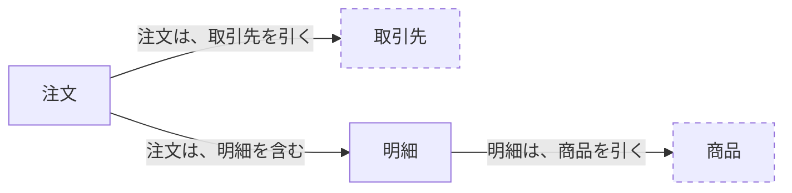

# 業務の対象

先に `facts.md` の事実の流れを読む。この文書には、事実と受け渡しの約束が運ぶ業務の対象について、何から成り、何で見分けるかだけを書く。

表の「その情報についての業務ルール（要約）と、未決事項」の欄は、`rules.md` の業務ルールを短くまとめたものである。食い違うときは、`rules.md` が正である。

要求資料から読める範囲と、AI の案（仮説）だけを書いた。届け先、単価など、要求資料にない情報は書いていない。

## 受注

### 注文

- 対象の種類：出来事の記録
- この対象が初めて記録される事実：注文が下書きとして保存された
- この対象が持つ情報を変える事実や操作：明細を変更する操作（下書きの間だけ）
- 同じ対象とみなす条件：？（Q-37）。この条件の合意状態：要確認

| この対象が持つ情報 | 状態が下書きのとき | 提出した後の状態のとき（与信確認中、在庫引当中、確定、出荷中、出荷済み、断った） | 状態が取消済みのとき | その情報の値は、どこから来るか | その情報についての業務ルール（要約）と、未決事項 | 合意状態 | 出所 |
| --- | --- | --- | --- | --- | --- | --- | --- |
| 取引先 | 必ずある | 必ずある | 必ずある | お客様が注文書で知らせ、受注担当者が入力する（注文が下書きとして保存された） | 取引先を引くだけか、その時点の値を写すかは ？（Q-40） | 要確認（Q-40） | 要求資料 §3、§4 |
| 明細 | 0 件以上 | 1 件以上 | ？（Q-13） | 同上。下書きの間は、明細を変更する操作で変わる | 提出するには 1 件以上（RULE-ORDER-01）。確定した後は変えられない（RULE-ORDER-04） | 仮説 | 要求資料 §6 |
| 注文の金額 | 必ずある | 必ずある | 必ずある | 明細から計算する | 明細の金額の合計（RULE-ORDER-03） | 要確認（Q-02） | 要求資料 §6 |

値を入れた見本：？（Q-39。注文書の記入例を、個人の情報などを伏せて、お客様からもらう）

### 明細

- 対象の種類：出来事の記録（注文の一部）
- この対象が初めて記録される事実：注文が下書きとして保存された（注文と一緒に記録される）
- この対象が持つ情報を変える事実や操作：明細を変更する操作（下書きの間だけ）
- 同じ対象とみなす条件：同じ注文の中で、並びの順番が同じであること。この条件の合意状態：仮説（受け渡しの約束「引当の結果を知らせる」が、足りなかった明細を運ぶので、注文の中で明細を一つずつ見分ける必要がある）

| この対象が持つ情報 | その情報は、必ずあるか | その情報は、いくつあるか | その情報の値は、どこから来るか | その情報についての業務ルール（要約）と、未決事項 | 合意状態 | 出所 |
| --- | --- | --- | --- | --- | --- | --- |
| 商品 | 必ずある | 1 | お客様が注文書で知らせ、受注担当者が入力する（注文が下書きとして保存された） | 商品を引くだけか、その時点の値を写すかは ？（Q-41） | 要確認（Q-41） | 要求資料 §5、§6 |
| 数量 | 必ずある | 1 | 同上 | 1 以上（RULE-ORDER-02） | 仮説 | 要求資料 §6 |
| 明細の金額 | 必ずある | 1 | ？（Q-38） | ？（Q-38） | 要確認（Q-38） | 要求資料 §6 |

値を入れた見本：注文の見本（Q-39）に含める。

この図は、上の注文と明細の、業務の対象の形の表から描いた。食い違うときは、表が正である。破線は、この文書で書かない対象である。

