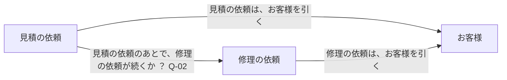

# 業務の対象

先に `facts.md` の事実の流れを読む。この文書には、事実と受け渡しの約束が運ぶ業務の対象について、何から成り、何で見分けるかだけを書く。

表の「その情報についての業務ルール（要約）と、未決事項」の欄は、`rules.md` の業務ルールを短くまとめたものである。食い違うときは、`rules.md` が正である。

要求資料と依頼書の様式から読める範囲と、AI の案（仮説）だけを書いた。画面の案と既存のテーブルの形は、そのまま写していない。項目ごとに、値がどこから来るかを確かめて書いた。製品は、初めて記録される事実も、外から受け取る約束も見つからないので、業務の対象として書かず、依頼が持つ情報として書いた（Q-18）。

## 修理受付

### お客様

- 対象の種類：続いて在るもの
- この対象が初めて記録される事実：お客様が登録された
- この対象が持つ情報を変える事実や操作：お客様の住所が変更された
- 同じ対象とみなす条件：？（Q-12）。この条件の合意状態：要確認

| この対象が持つ情報 | その情報は、必ずあるか | その情報は、いくつあるか | その情報の値は、どこから来るか | その情報についての業務ルール（要約）と、未決事項 | 合意状態 | 出所 |
| --- | --- | --- | --- | --- | --- | --- |
| お名前 | ？（Q-11） | 1 | お客様が知らせ、受付担当者が登録する（お客様が登録された） | 登録は受付担当者が行う（RULE-REPAIR-06） | 要確認（Q-11） | 要求資料（抜粋）、修理依頼書の様式 |
| 住所 | ？（Q-11） | 1 | お客様が知らせ、受付担当者が登録する（お客様が登録された）。依頼書のどの欄から得るかは ？（Q-10）。変わったときは、受付担当者が直す（お客様の住所が変更された） | 住所が変わったら、登録を直す（RULE-REPAIR-07）。直す前の住所を後で調べるかは ？（Q-15） | 要確認（Q-10、Q-11、Q-15） | 要求資料（抜粋） |
| 電話番号 | ？（Q-11） | 1 | お客様が知らせ、受付担当者が登録する（お客様が登録された） | 登録は受付担当者が行う（RULE-REPAIR-06） | 要確認（Q-11） | 要求資料（抜粋）、修理依頼書の様式 |

値を入れた見本：？（Q-35）

### 見積の依頼

- 対象の種類：出来事の記録
- この対象が初めて記録される事実：見積の依頼が受け付けられた
- この対象が持つ情報を変える事実や操作：見積の金額が連絡された
- 同じ対象とみなす条件：？（Q-16）。この条件の合意状態：要確認

| この対象が持つ情報 | 状態が受付済みのとき | 状態が見積連絡済みのとき | その情報の値は、どこから来るか | その情報についての業務ルール（要約）と、未決事項 | 合意状態 | 出所 |
| --- | --- | --- | --- | --- | --- | --- |
| お客様 | 必ずある | 必ずある | 前に起きた事実から（お客様が登録された。登録を済ませてから受け付けるかは Q-13） | 登録を引くだけか、受け付けた時点の値を写すかは ？（Q-14） | 要確認（Q-13、Q-14） | 要求資料（抜粋）、既存のコード（customer_id は必須） |
| 製品の種類 | ？（Q-20） | ？（Q-20） | お客様が、依頼書の製品の種類の欄に書く（見積の依頼が受け付けられた） | 製品を依頼とは別に記録するかは Q-18 | 要確認（Q-18、Q-20） | 修理依頼書の様式 |
| 型番 | 必ずある | 必ずある | お客様が、依頼書の型番の欄に書く（見積の依頼が受け付けられた） | 必ず書かれるかは Q-20 | 要確認（Q-20） | 修理依頼書の様式、既存のコード（product_model は必須） |
| 購入日 | ？（Q-20） | ？（Q-20） | お客様が、依頼書の購入日の欄に書く（見積の依頼が受け付けられた） | 何に使うかは ？（Q-19） | 要確認（Q-19、Q-20） | 修理依頼書の様式 |
| 症状 | 必ずある | 必ずある | お客様が、依頼書の症状の欄に書く（見積の依頼が受け付けられた） | — | 仮説 | 修理依頼書の様式、既存のコード（symptom は必須） |
| 受付日 | 必ずある | 必ずある | 受付担当者が、依頼書の受付日の欄に書く（見積の依頼が受け付けられた） | 郵送のときの日は ？（Q-22） | 要確認（Q-22） | 修理依頼書の様式 |
| 返送先の住所 | ？（Q-01） | ？（Q-01） | お客様が、依頼書の返送先の住所の欄に書く（見積の依頼が受け付けられた） | 要求資料は、返送先を「修理を依頼」の場合にだけ述べている。既存のコードも、「修理を依頼」のときにだけ必須にしている。「見積だけ」の依頼でもあるかは ？（Q-01） | 要確認（Q-01） | 要求資料（抜粋）、既存のコード |
| 見積の金額 | ？（Q-04） | 必ずある | 修理担当者が、症状を見て決め、依頼書の欄に書く。お客様に連絡する（見積の金額が連絡された）。書くことと連絡することが別の出来事かは ？（Q-04） | 連絡した後で直せるかは ？（Q-33） | 要確認（Q-04、Q-33） | 要求資料（抜粋）、修理依頼書の様式 |

- 依頼書の受付印は、何を表すか、受付日と別に記録するかが分からないので、業務の対象の形の表に書かない（Q-21）。
- 受付番号は、依頼書の様式に欄がない。誰が、いつ付けるかは Q-17、受付番号で依頼を見分けるかは Q-16 を引く。
- 見積の依頼のあとで、修理の依頼が続くことがあるかは、Q-02 を引く。
- 見積の金額を連絡した日時を持つかは、Q-04 を引く。

値を入れた見本：？（Q-35）

### 修理の依頼

- 対象の種類：出来事の記録
- この対象が初めて記録される事実：修理の依頼が受け付けられた
- この対象が持つ情報を変える事実や操作：修理が完了した
- 同じ対象とみなす条件：？（Q-16）。この条件の合意状態：要確認

| この対象が持つ情報 | 状態が受付済みのとき | 状態が修理完了のとき | その情報の値は、どこから来るか | その情報についての業務ルール（要約）と、未決事項 | 合意状態 | 出所 |
| --- | --- | --- | --- | --- | --- | --- |
| お客様 | 必ずある | 必ずある | 前に起きた事実から（お客様が登録された。登録を済ませてから受け付けるかは Q-13） | 登録を引くだけか、受け付けた時点の値を写すかは ？（Q-14） | 要確認（Q-13、Q-14） | 要求資料（抜粋）、既存のコード（customer_id は必須） |
| 製品の種類 | ？（Q-20） | ？（Q-20） | お客様が、依頼書の製品の種類の欄に書く（修理の依頼が受け付けられた） | 製品を依頼とは別に記録するかは Q-18 | 要確認（Q-18、Q-20） | 修理依頼書の様式 |
| 型番 | 必ずある | 必ずある | お客様が、依頼書の型番の欄に書く（修理の依頼が受け付けられた） | 必ず書かれるかは Q-20 | 要確認（Q-20） | 修理依頼書の様式、既存のコード（product_model は必須） |
| 購入日 | ？（Q-20） | ？（Q-20） | お客様が、依頼書の購入日の欄に書く（修理の依頼が受け付けられた） | 何に使うかは ？（Q-19） | 要確認（Q-19、Q-20） | 修理依頼書の様式 |
| 症状 | 必ずある | 必ずある | お客様が、依頼書の症状の欄に書く（修理の依頼が受け付けられた） | — | 仮説 | 修理依頼書の様式、既存のコード（symptom は必須） |
| 受付日 | 必ずある | 必ずある | 受付担当者が、依頼書の受付日の欄に書く（修理の依頼が受け付けられた） | 郵送のときの日は ？（Q-22） | 要確認（Q-22） | 修理依頼書の様式 |
| 返送先の住所 | 必ずある | 必ずある | お客様が、依頼書の返送先の住所の欄に書く（修理の依頼が受け付けられた） | 返送先は、依頼書に書かれた住所とする（RULE-REPAIR-04）。書かれていなければ受け付けられない（RULE-REPAIR-05。Q-32）。お客様の登録の住所が変わったら一緒に変わるのか、依頼書に書かれた時点のまま残るのかは ？（Q-09） | 要確認（Q-09、Q-32） | 要求資料（抜粋）、既存のコード（「修理を依頼」のときだけ必須） |
| 見積の金額 | ？（Q-03） | ？（Q-03） | 修理担当者が、症状を見て決め、依頼書の欄に書く。「修理を依頼」のときにもあるか、修理の代金との関係は ？（Q-03、Q-07） | — | 要確認（Q-03、Q-07） | 修理依頼書の様式 |
| 修理が完了した日時 | ない | 必ずある | 修理担当者が、修理が終わったことを記録する（修理が完了した） | 記録を直せるかは ？（Q-29） | 要確認（Q-29） | 要求資料（抜粋）、既存のコード（repaired_at） |

- 依頼書の受付印は、何を表すか、受付日と別に記録するかが分からないので、業務の対象の形の表に書かない（Q-21）。
- 受付番号は、依頼書の様式に欄がない。誰が、いつ付けるかは Q-17、受付番号で依頼を見分けるかは Q-16 を引く。
- 返送した日時、請求した日時を持つかは、Q-05、Q-06 を引く。

値を入れた見本：？（Q-35）

この図は、上のお客様、見積の依頼、修理の依頼の、業務の対象の形の表から描いた。食い違うときは、表が正である。

